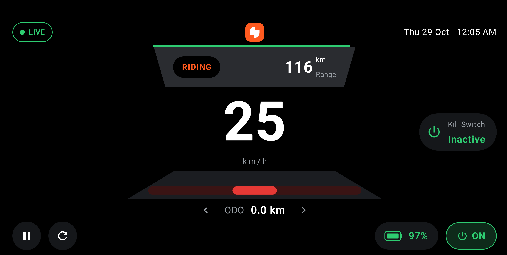
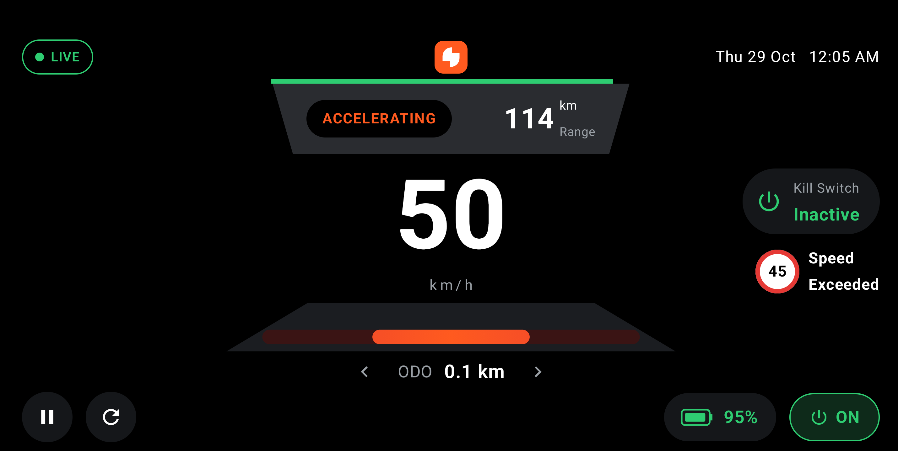
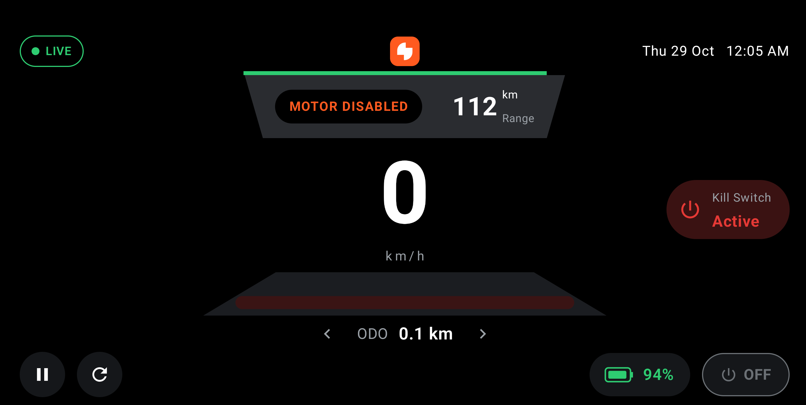
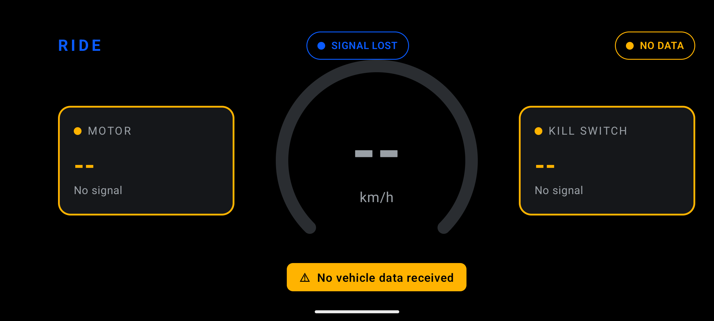

# Ride HMI Dashboard

A landscape Android dashboard for a two-wheeler. It shows speed, motor status and kill switch
status, using data from a simulator, so no hardware is needed.

Built with Kotlin, Jetpack Compose, Coroutines, StateFlow and a ViewModel.






## Build and run

You need Android Studio with SDK 37 and an emulator running API 24 or higher.

1. Open the project in Android Studio and let Gradle sync.
2. Start an emulator.
3. Run the `app` configuration.

From the terminal:

```bash
./gradlew assembleDebug
adb install -r app/build/outputs/apk/debug/app-debug.apk
```

Use `gradlew.bat` on Windows.

## Run the tests

Unit tests, no emulator needed:

```bash
./gradlew testDebugUnitTest
```

UI tests, with an emulator running:

```bash
./gradlew connectedDebugAndroidTest
```

Reports go to `app/build/reports/`. You can also right-click the `test` or `androidTest`
folder in Android Studio and run them from there.

What the tests cover:
- `DashboardViewModelTest`: state updates for each scenario, invalid speed, missing
  signals, stale data, data source errors, overspeed, battery and range, trip distance,
  cached trip values, pause/resume and restart.
- `SimulatedVehicleDataSourceTest`: scenario order and values, one update per second,
  restart, and battery drain.
- `DashboardScreenTest` (UI): the main states show up correctly, the trip slider works, and
  the Pause, Resume and Restart buttons work.

## Project structure

```
data/
  VehicleState.kt                - raw signals from the vehicle
  VehicleDataSource.kt           - interface for the data source
  SimulatedVehicleDataSource.kt  - the simulator
  TripInfo.kt                    - odometer, trip distance and top speed
  TripCache.kt                   - saves trip values with SharedPreferences
  TimeProvider.kt                - current time, so tests can control it
ui/
  DashboardUiState.kt            - what the screen shows
  DashboardViewModel.kt          - checks the data and exposes a StateFlow
  DashboardScreen.kt             - screen layout
  DashboardComponents.kt         - smaller pieces like pills, alerts and buttons
  theme/                         - colors and theme
di/
  AppModule.kt                   - Hilt module that provides the dependencies
RideHmiApplication.kt            - Hilt application class
MainActivity.kt
```

## How it works

```
SimulatedVehicleDataSource -> DashboardViewModel -> DashboardScreen
```

- The simulator is a `flow` that sends a new `VehicleState` every second.
- The ViewModel collects it in `viewModelScope`, checks the values and updates a `StateFlow`.
- The screen collects the state with `collectAsStateWithLifecycle()`, so it updates on its
  own.
- The ViewModel doesn't hold any display text. It uses enums like `MotorStatus`, and the
  screen turns them into text from `strings.xml`.
- The ViewModel only depends on the `VehicleDataSource`, `TripCache` and `TimeProvider`
  interfaces. Hilt injects the real ones, and the unit tests pass in fakes.

## Simulation

Each step lasts about 3 seconds, then it starts over:

- Parked: 0 km/h, motor OFF, kill switch inactive
- Ready: 0 km/h, motor ON, kill switch inactive
- Riding: 25 km/h, motor ON, kill switch inactive
- Accelerating: 50 km/h, motor ON, kill switch inactive
- Motor disabled: 0 km/h, motor OFF, kill switch active
- Sensor fault: -12 km/h, to show the invalid speed handling
- Signal lost: all values missing, then nothing for 5 seconds, to show the stale data handling

The last two can be turned off with `SimulatedVehicleDataSource(includeFaultDemo = false)`.

Battery starts at 100% and drops 1% for every second the vehicle is moving. Range is
worked out from it, assuming about 120 km on a full charge.

## Edge cases

- **Invalid speed** (below 0 or above 150 km/h): speed shows `--` and a warning appears.
- **Missing signal**: that value shows `--`.
- **Stale data** (nothing for 3 seconds): all values are cleared and the status changes to
  NO DATA, so an old speed is never shown as current.
- **Data source error**: caught, and a message is shown instead of a crash.

## Dashboard layout

Based on the reference image in the assignment:

- **Top bar**: LIVE / NO DATA / PAUSED status, the logo, and the date and time.
- **Top panel**: current scenario, range, and a battery bar along the top edge.
- **Centre**: speed in large digits with a red speed bar under it.
- **Trip slider**: ODO, TRIP and TOP SPEED, switched with the arrows.
- **Right side**: kill switch status (red when active), speed exceeded alert and warnings.
- **Bottom bar**: Pause/Resume and Restart buttons, battery level and motor status.

## Optional extras

- **Dependency injection**: Hilt. `AppModule` provides the data source, the trip cache and
  the time provider as singletons. `DashboardViewModel` is a `@HiltViewModel` and
  `MainActivity` gets it with `hiltViewModel()`. To use real vehicle data, change
  `provideVehicleDataSource()` in `AppModule`.
- **Caching**: odometer, trip distance and top speed are saved with SharedPreferences, so
  they're still there after the app is closed.
- **Extra features**: date and time, battery and range, a speed exceeded alert above
  45 km/h, and the trip slider.
- **Pause and restart**: Pause freezes the screen without showing a "no data" warning.
  Resume carries on where it stopped. Restart goes back to Parked and clears the trip, but
  keeps the odometer.
- **UI tests**: Compose tests in `app/src/androidTest`.

## App name and icon

- The app is called **Ride HMI**.
- The icon is the "S" mark from the Simple logo, white on blue.
- Android 8 and newer use an adaptive vector icon. Android 7 uses the PNGs in `mipmap-*`.

## Assumptions and limitations

- The scenario values are examples from the assignment, not safety rules.
- The 150 km/h limit, 45 km/h overspeed limit and 3 second timeout are my own choices for a
  scooter.
- Trip distance is estimated from speed samples.
- Battery and range are simulated.
- Only part of the reference design is done. Indicators, high beam, TPMS and notifications
  are left out because the simulator has no data for them.
- The landscape lock works on phones. On Android 16+ tablets and foldables the system may
  ignore it, but the layout still stretches to fit.
